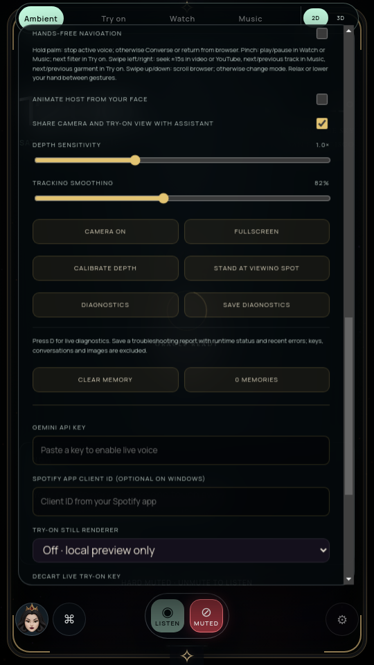

# Final Windows handoff wave — October 10, 2026

The Windows preview now includes **Debug Mirror.cmd** and **Settings → Save diagnostics**. Debug opens DevTools even when the mirror is already running. Export uses a native save dialog and includes runtime state, platform/display/GPU information, build source fingerprints and recent lifecycle events. Keys, transcripts, images, browser URLs, notes and garment names are excluded by an explicit field allowlist. The same restriction applies to events read back from disk.

Lifecycle events persist in the application user-profile diagnostics folder, with two rotating 128 KiB files, at most 64 pending writes and at most 200 exported events. Unavailable storage is reported without crashing the app. Shutdown waits for writes for at most one second. Monitor runs now preserve the journal and bounded runtime output before deleting their temporary profiles, including when renderer observation fails.

The watchdog cancels pending agent, browser, photo/lookbook, cloud token, casting and phone-pairing work before recovery. Transient stalls that become responsive do not reload. At most three automatic reloads are allowed in a rolling minute; further crashes pause recovery and offer Retry, Open diagnostic logs or Close mirror. Closing the window clears its pending watchdog timer.

Actual crash testing also exposed disposed-frame IPC during desktop/agent cleanup. Cleanup now avoids sending notifications into a crashed, navigating or destroyed renderer; normal Stop still notifies the live page. Deliberately canceled initial loads no longer become false load-failure records.

## Verification

[Exact archive/source hashes, checks and combined-run record](FINAL-WAVE-VERIFICATION.json).

- Full automated suite and health check passed.
- Production-function tests cover recovery limits, timer cancellation, retry, aged attempts and failed cleanup/reload. Native export handlers are exercised with trusted/untrusted frames, actual file writes, canceled dialogs, concurrent exports, failed writes and retry.
- Packaged Electron tests force real renderer crashes, verify three automatic reloads and a recovery limit while the main process remains alive, retain hard mute, retire pending HTTP navigation and phone pairing, and open Debug on an existing instance. Test output contains no disposed-frame IPC errors.
- Packaged wardrobe journey and four-viewport layout audit pass on the final application archive.
- A short accelerated NVIDIA recorded-camera/local-AR/synthetic-speech run exercises camera off, active AR, mirror and sleep transitions. Its exact duration, samples and errors are recorded in the verification JSON. It does not replace an eight-hour release soak or physical-device testing.
- The rebuilt Windows x64 ZIP has the same application archive as the tested Linux build. All 110 application scripts/styles/HTML/PowerShell files match the checkout; ZIP integrity, bundled models and all three launchers are checked.

[Download the updated Windows preview](https://github.com/architdeepak/magicmirror/releases/tag/windows-preview-2026-10-10-final). Close the old app, extract the complete new ZIP into a new folder, configure with **Open Settings Window.cmd**, then use **Start Mirror.cmd**. Settings and saved garments remain in the same user profile.

Actual Windows launch, stick/TV performance, physical camera/microphone/audio/gestures, local Spotify/native input and phone interoperability remain unverified. Garment drape and 3D avatar quality remain partial. The previous 24-minute timeout is still unresolved; its frozen source is separate from these passing checks. All full-suite release gates remain open.
