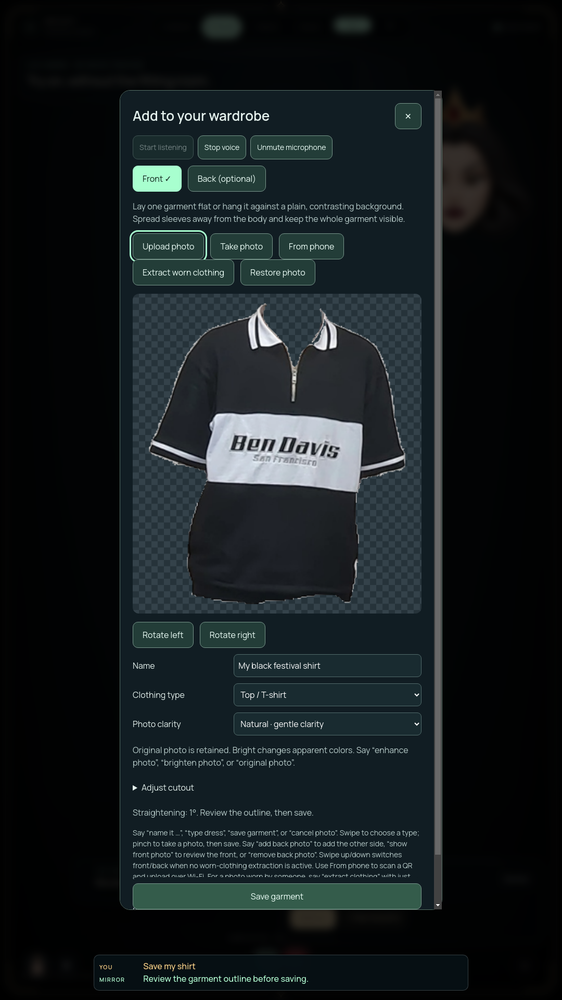

# Wardrobe photo orientation — 2026-10-10

The shoulder-anchor review exposed tilted source photos that needed correction before silhouette inference. The wardrobe editor now offers left/right quarter turns and a −10° to +10° straightening slider under **Adjust cutout**. Voice commands support “rotate photo left/right” and one-degree “straighten left/right” adjustments. Assistant state reports both angles.

Every preview starts from the unmodified source or extracted clothing pixels, so inverse adjustments and four quarter turns return to the original preview exactly. Front and optional back drafts retain independent orientation, crop and clarity settings. Restore resets orientation; new uploads and captures start at zero. Quarter turns reset crop edges for the new vertical axis. Rotation fits its expanded canvas within 1024 pixels and runs only during editing, without adding camera-loop work.

Saving keeps the reviewed cutout and the original upload. PNG persistence re-encodes the cutout, so verification compares decoded pixel hashes rather than encoded PNG bytes. Reopening a saved garment starts from its original photos; orientation settings are draft state, not persisted editing metadata.

## Verification

[Exact package, source hashes and runtime reports](PHOTO-ORIENTATION-VERIFICATION.json).

- Full unit suite and health check pass.
- Packaged wardrobe journey covers quarter-turn reversal, four-turn restoration, fine-angle reversal, button rotation, Restore, an empty back, independent populated front/back orientation, and saved decoded pixels matching the reviewed front even when saving from the back view.
- Existing journey checks retain original JPEG bytes, local persistence/reload, worn extraction, synthetic capture/gesture routes, editor Stop/mute/captions and paired phone upload.
- Packaged four-viewport UI audit passes with no renderer exceptions.

This is intake correction, with approximate garment drape and silhouette acceptance still subject to review. Physical camera/voice/gesture recognition, Windows and all full-suite release gates remain open. The older selection-summary monitor is independent of this package.
